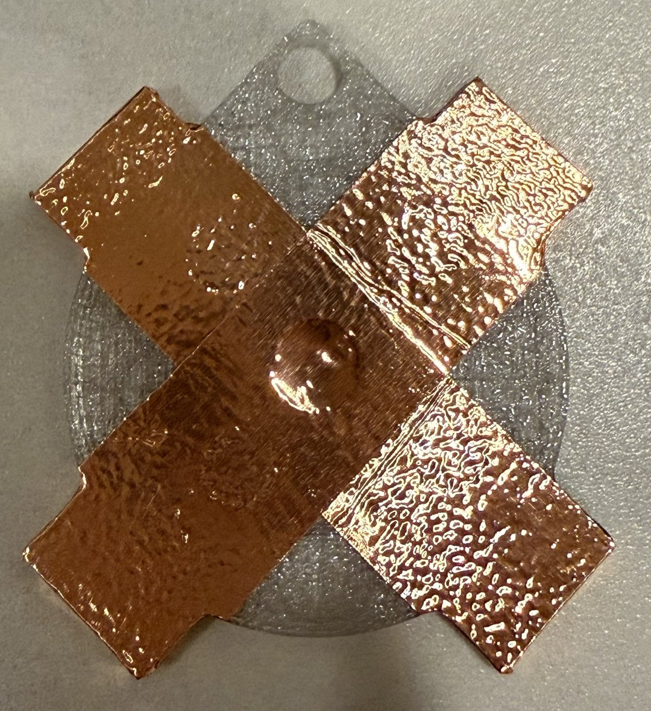
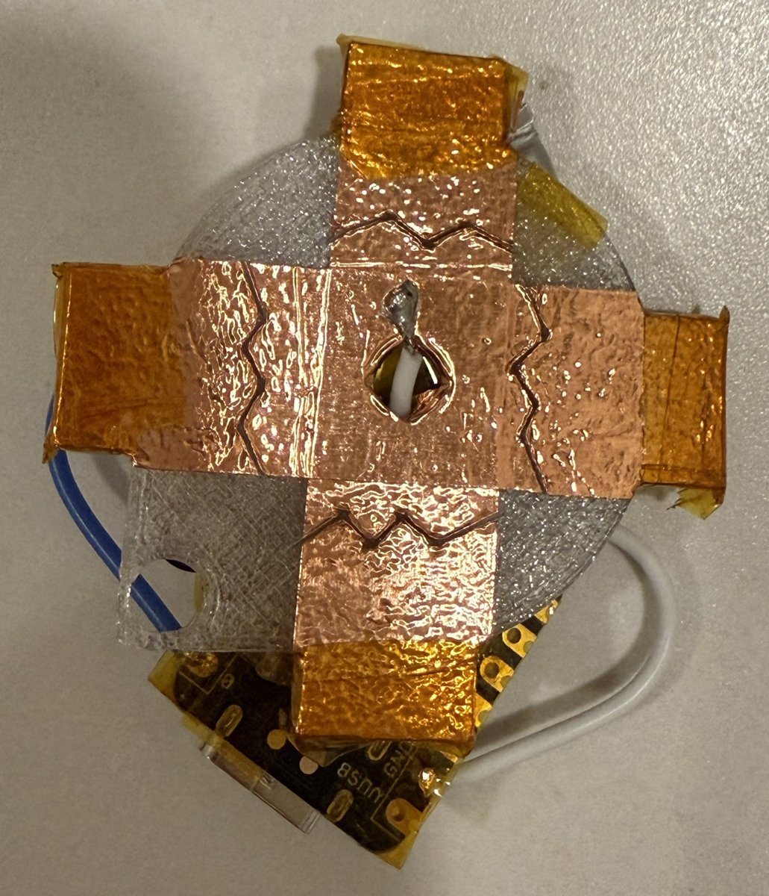
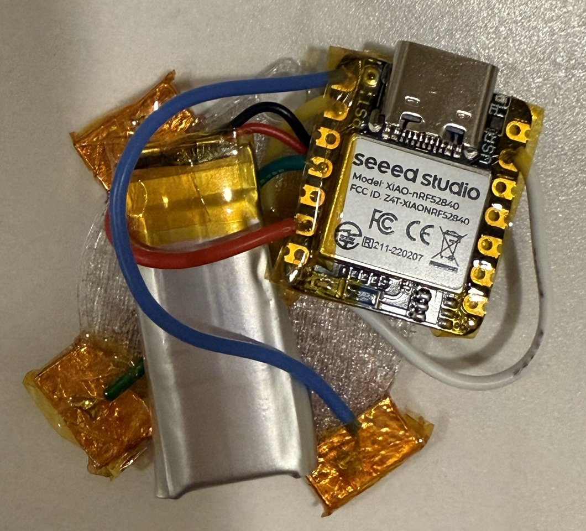
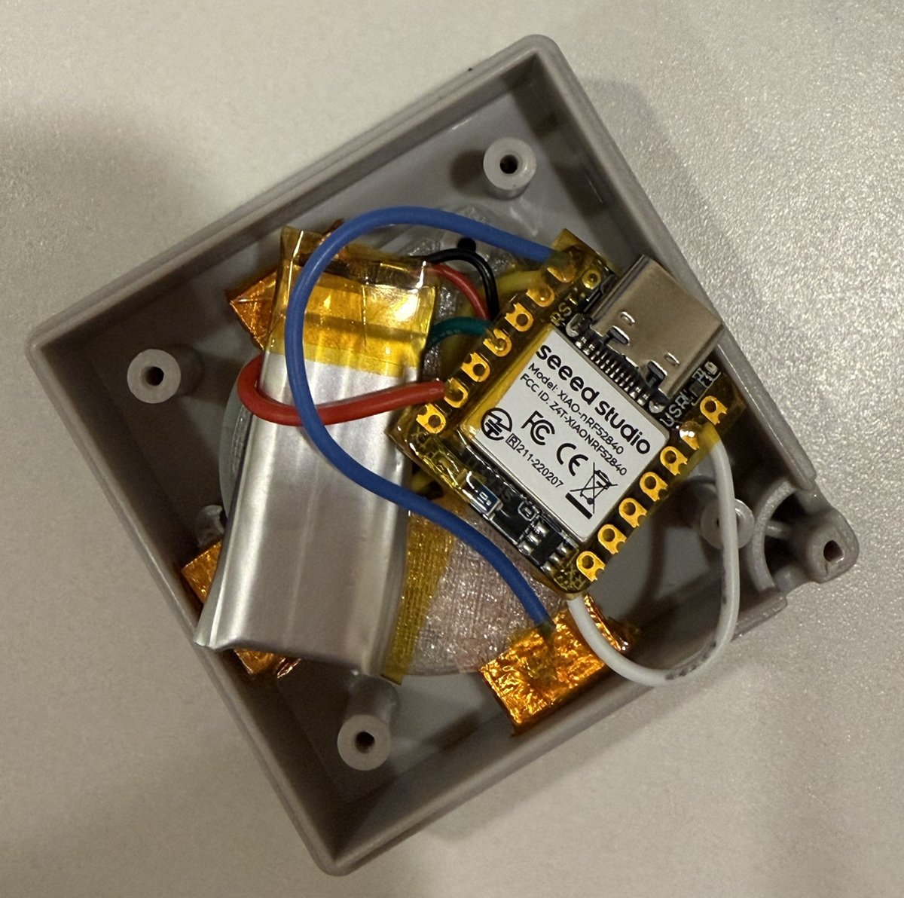

# Hardware Build Guide & Bill of Materials

This document details the exact hardware components, wiring materials, consumables, and bench tools used to construct the miniature Kindle-compatible D-pad remote.

> **Affiliate disclosure:** The Amazon links in this document are Amazon affiliate links. As an Amazon Associate I earn from qualifying purchases, at no extra cost to you. Any equivalent part or tool from any seller works equally well.

---

## 1. Components & Materials

| Part | Specification / What We Used | Notes / Links |
| :--- | :--- | :--- |
| **Microcontroller** | Seeed Studio XIAO nRF52840 (plain, non-Sense) | Compact BLE 5.0 board (21 × 17.8 mm), onboard LiPo charging circuit and battery pads. ([Amazon, affiliate link](https://link.amazon/B09HYrQCm)) |
| **Battery** | 3.7V 100 mAh LiPo (Model 401230) with protection circuit (PCM) | Dimensions ~4.0 × 12 × 30 mm. Fits alongside the XIAO board within the 32 mm enclosure width. ([Amazon, affiliate link](https://link.amazon/B08Uz6OzR)) |
| **Conductive Tape** | Copper foil tape with conductive adhesive (2" width) | Used to cut the central ground cross and four directional contact pads under the carbon pills. ([Amazon, affiliate link](https://link.amazon/B05feoZ6u)) |
| **Insulation Tape** | High-temperature polyimide (Kapton) tape (~10 mm / 3/8" width) | Insulates the battery PCM, solder pads, and underside of the board. ([Amazon, affiliate link](https://link.amazon/B0hgt1rSp)) |
| **Enclosure** | Nintendo NES controller D-pad keychain capsule toy (Gashapon) | Original silicone membrane with conductive carbon pills (100–400 Ω). Usable cavity: 35 × 32 × 7 mm. |
| **Insert** | 3D-printed PETG replacement insert | Holds the cell, XIAO, routing channels, and pad recesses. (PETG preferred over PLA for thermal stability). |
| **Wiring** | 28 AWG flexible stranded silicone wire | Ultra-flexible wire for routing pad tails to XIAO GPIOs without lifting tape. ([Amazon, affiliate link](https://link.amazon/B03ewY7C5)) |

---

## 2. Tools & Consumables

| Tool | What We Use | Notes / Links |
| :--- | :--- | :--- |
| **Soldering Station** | Hakko FX888DX | Temperature-controlled station (~330 °C). ([Amazon, affiliate link](https://link.amazon/B0F55YPC2T)) |
| **Solder** | Kester 44, 63/37 rosin core (0.031" / 0.8 mm) | High-reliability eutectic solder for fine SMD pads. ([Amazon, affiliate link](https://link.amazon/B0hwdAo0T)) |
| **Desoldering Braid** | Chemtronics Chem-Wik (0.050") | For cleaning pad bridges or reworking solder joints. ([Amazon, affiliate link](https://link.amazon/B0gyaL1mR)) |
| **Multimeter** | Digital Multimeter with continuity beeper (e.g. Fluke 117) | Crucial for checking battery polarity and open/closed circuit status of copper pads. ([Amazon, affiliate link](https://link.amazon/B0etiLtlS)) |
| **Hobby Knife** | Precision knife with fresh #11 blade | Used to cut the 0.3–0.5 mm zigzag gap across copper pads to isolate signal from ground. |
| **Flush Cutters** | Precision wire flush cutters | For trimming component leads and wire ends flush to pads. |

> *Note: The Amazon links above are Amazon affiliate links (see the disclosure at the top). Any equivalent part or tool from any seller works equally well.*

---

## 3. Preparation & Assembly Notes

### 3.1 Battery Polarity & Preparation
1. **Always verify polarity with a multimeter before connecting.** Micro JST lead colors and pinouts frequently vary between suppliers.
2. Cut off the JST connector and tin the wire ends.
3. Fold the protection circuit module (PCM) flat against the battery edge and wrap securely with Kapton tape.
4. Solder short positive/negative leads to the respective `BAT+` and `BAT-` pads on the underside of the XIAO nRF52840.

### 3.2 Copper Tape Pad Fabrication
1. **Bench Soldering:** Tin the copper tape contact tails and solder the 28 AWG wires on a bench (or ceramic tile) **before** sticking the tape onto the 3D-printed PETG insert. Soldering directly against plastic will melt the carrier.
2. **Ground Cross & Signal Pads:** Lay a continuous central ground cross whose arms sit under the inner half of each membrane pill. Place signal pads under the outer halves.

   

   *Copper tape laid as a cross on the clear PETG insert, before the isolation cuts.*
3. **Zigzag Gap:** Using a fresh #11 blade, slice a 0.3–0.5 mm zigzag gap dividing each pad into separate signal and ground sections under the carbon pill.
4. **Continuity Check:** Check with a multimeter:
   - **Unpressed:** Open circuit (infinite resistance).
   - **Pressed:** ~100–400 Ω across signal to ground.

   

   *Zigzag cuts isolate the four outer signal pads from the central ground; the folded tails are covered with Kapton. The ground wire comes up through the center hole.*

### 3.3 Final Assembly

 

*Left: underside of the insert with the XIAO nRF52840 and the 401230 cell soldered and wired to the pad tails. Right: everything fitted into the keychain shell, USB-C toward the case edge for charging.*
